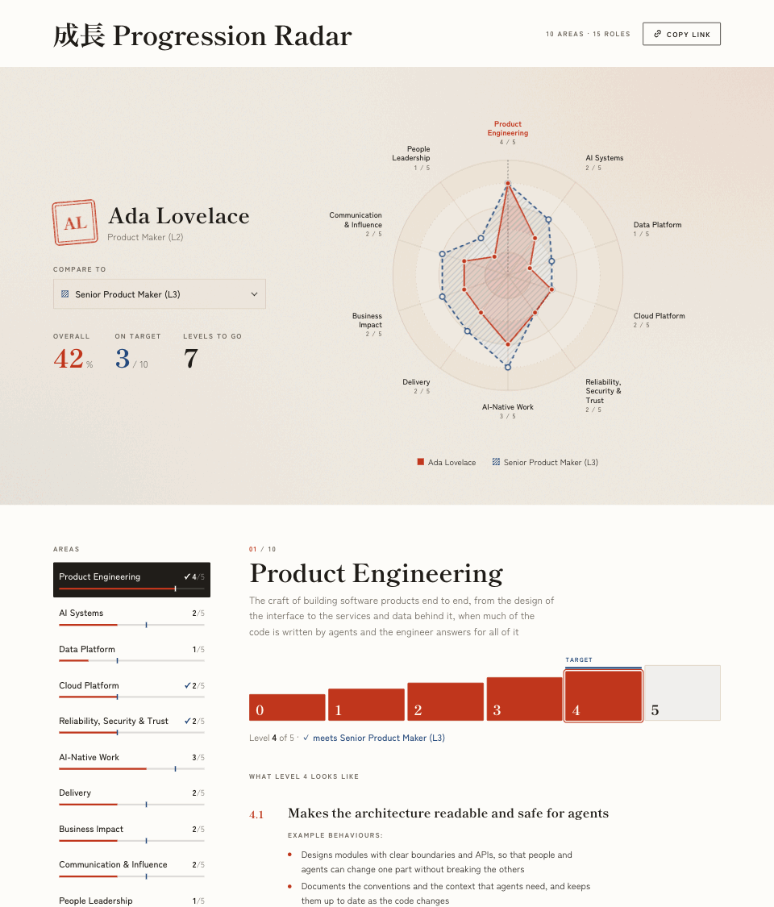

# Progression Radar

[](https://github.com/asiermarques/progression-radar/actions/workflows/ci.yml)
[](https://app.netlify.com/sites/progression-radar/deploys)

Progression Radar is a simple visualisation tool for career and learning paths. Inspired by Medium's deprecated
Snowflake tool, it shows the level a person has reached in each area of a path and compares it with the levels a
role requires. There is no backend: the whole state lives in the URL, so a link is a shareable snapshot.

To keep a record of a person over time, [snapshot commands](docs/guides/snapshots.md) save the link in dated CSV files on your
machine.

Live demo: [https://progression-radar.netlify.app](https://progression-radar.netlify.app/)



## What you can do with this tool

**See where a person stands**

- Draw the level a person has reached in each category on a radar, as a percentage of the highest level.
- Compare them with any role of your ladder: the required levels on the same radar, and a summary of the categories on
  target and the levels still to go.
- Read the expectations of every level of a category.
- Share a person by sending a link, or keep it in a bookmark: the whole state is in the URL.
  See [The share link](docs/guides/share-link.md).

**Make it yours**

- Write your own ladder as one Markdown file per category: [Categories](docs/guides/categories.md) and
  [Roles](docs/guides/roles.md).
- Set the title, logo and footer, and choose where your configuration lives:
  [Configuration](docs/guides/configuration.md).
- Change colours, fonts and styles, including a dark mode: [Styles](docs/guides/styles.md).
- Still have a `categories.yml` from an earlier version? Convert it with `npm run config:convert-categories`.

**Keep a record over time**

- Save people in dated CSV snapshots, open them again as they were, and check them against your current ladder, from
  the command line or by asking Claude. See [Snapshots](docs/guides/snapshots.md).

**Publish and maintain it**

- Install it as a dependency of a repository that holds only your configuration and snapshots, and upgrade by changing
  a version: [Getting started](docs/guides/getting-started.md).
- Deploy it as static files anywhere, with a check that stops a CI from publishing an invalid configuration:
  [Deployment](docs/guides/deployment.md).
- Upgrade, move a fork to a dependency, or keep a fork up to date: [Upgrading](docs/guides/upgrading.md).

## Quick start

You need [Node.js](https://nodejs.org) 22.12 or newer (Node 24 LTS is recommended).

### Use it for your organisation (recommended)

Install the radar as a dependency of your own repository. That repository holds only your ladder (`config/`), your
snapshots and a `package.json`; you never merge upstream, and upgrading is changing a version.

> **Before 1.0 is on npm**, `progression-radar` on npm is the old 0.x library: replace `npm install progression-radar`
> below with `npm install github:asiermarques/progression-radar`.

```sh
mkdir my-ladder && cd my-ladder
git init && npm init -y
npm install progression-radar
npx progression-radar init    # copies the sample ladder to config/ and adds the npm scripts
npm run dev
```

Edit the files in `config/` and the page reloads. `npm run build` writes the static site to `dist/`. It works with
npm, pnpm and Yarn. Step by step, with the layout, `.gitignore` and CI: [Getting started](docs/guides/getting-started.md).

### Try it, or fork it to change the code

```sh
git clone git@github.com:asiermarques/progression-radar.git
cd progression-radar
npm install
npm run dev
```

A fresh clone runs with a sample ladder, with no setup. Fork it only if you need to change `src/`: see
[Getting started](docs/guides/getting-started.md#try-it-or-fork-it-to-change-the-code).

## Documentation

### Guides

- [Getting started](docs/guides/getting-started.md): install it as a dependency (recommended) or fork it, and the
  list of npm scripts.
- [Configuration](docs/guides/configuration.md): the config folder, the sample as fallback, `site.yml` and validation.
- [Categories](docs/guides/categories.md): category files, converting an old `categories.yml` and reserved keys.
- [Roles](docs/guides/roles.md): `roles.yml`.
- [Styles](docs/guides/styles.md): `theme.css`, colours, fonts and class names.
- [The share link](docs/guides/share-link.md): the URL format and how old or partly outdated links are read.
- [Snapshots](docs/guides/snapshots.md): record, reopen and check people over time.
- [Deployment](docs/guides/deployment.md): static hosting, Netlify and the CI check.
- [Upgrading](docs/guides/upgrading.md): upgrading the dependency, moving a fork to a dependency, and what a fork does
  after an update.

### About the project

- [docs/PRODUCT.md](docs/PRODUCT.md): what it does, who it is for and the product decisions.
- [docs/ARCHITECTURE.md](docs/ARCHITECTURE.md): stack, layout of the code, data flow and key decisions.
- [docs/DESIGN.md](docs/DESIGN.md): the design system and UI guidelines.
- [docs/UBIQUITOUS_LANGUAGE.md](docs/UBIQUITOUS_LANGUAGE.md): the glossary of domain terms (category, expectation,
  level, role…) and the words to avoid.
- [docs/adr/](docs/adr): architecture decision records.
