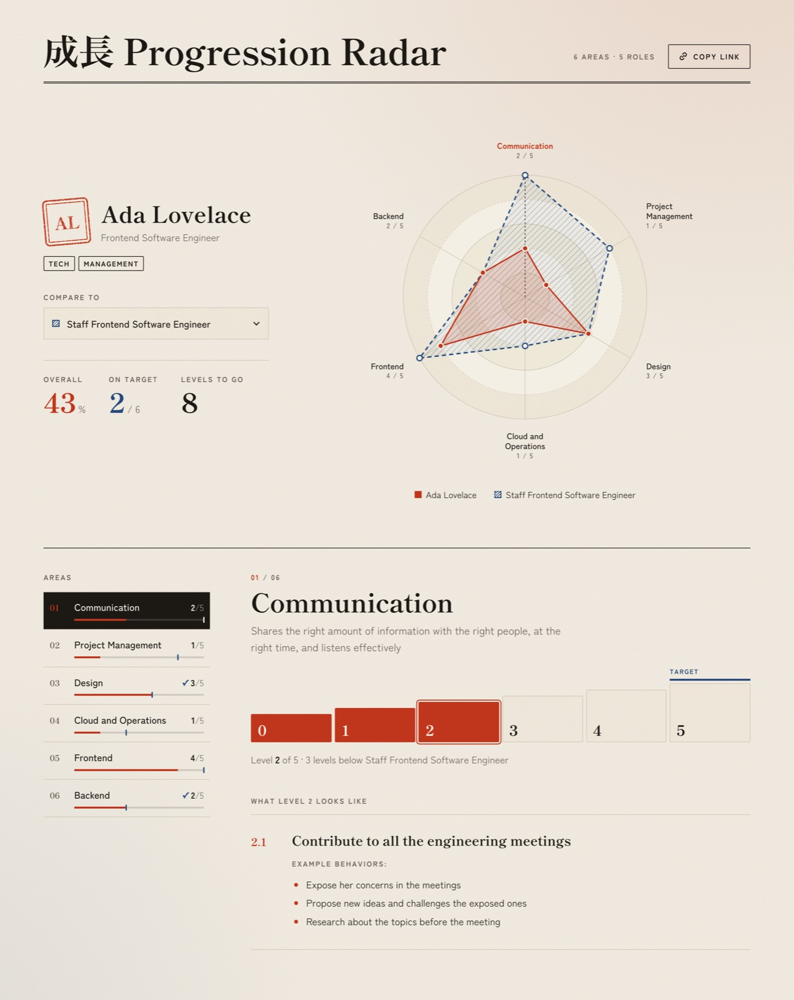

# Design

How Progression Radar looks and why, and the rules to follow when changing or adding UI. Read it together with
[PRODUCT.md](PRODUCT.md) (what the app does) and [ARCHITECTURE.md](ARCHITECTURE.md) (how it is built).



## Concept: a printed growth record

The default theme is inspired by Japanese print, after the 成長 ("growth") in the demo title. The page should feel
like a carefully typeset sheet that a manager and a person sit down with, not like a dashboard.

| metaphor            | in the UI                                                                       |
|---------------------|---------------------------------------------------------------------------------|
| washi paper         | warm off-white background with a fractal-noise grain (`--texture`)             |
| sumi ink            | near-black text, ink-filled active states, double rules framing the page        |
| vermilion seal      | the person: their hanko with initials, their radar series, the levels reached   |
| indigo              | the compared role: its radar series, the target level, categories "on target"   |
| mincho type         | editorial serif for titles, names and every number                              |

Three things carry the identity and must survive any change: the **seal**, the **two-colour person vs. role
language** and the **serif numbers**. Everything else stays quiet: few colours, thin rules, generous space.

The theme is only a default. Adopters re-brand from `config/theme.css`, so every visual decision must be expressed
through the custom properties and stable class names described below, never hard-coded.

## Colour

### Tokens

Defined in `:root` in `src/styles.css`, with a dark palette in `@media (prefers-color-scheme: dark)`.

| token                | light     | dark      | role                                                        |
|----------------------|-----------|-----------|-------------------------------------------------------------|
| `--color-primary`    | `#c0361c` | `#ef6a4c` | accent: seal, reached levels, indices, links, focus ring    |
| `--color-on-primary` | `#fff8ee` | `#1a0d08` | text on top of the accent                                   |
| `--color-person`     | `#c0361c` | `#ef6a4c` | the person's radar series, overall %, meter fill            |
| `--color-compare`    | `#24497d` | `#8fb0e3` | the compared role: series, target marker, "met" checks      |
| `--color-text`       | `#1c1915` | `#ede6d9` | ink: body text, rules, inverted (active) backgrounds        |
| `--color-muted`      | `#6a6258` | `#a39a8c` | labels, secondary text, descriptions                        |
| `--color-border`     | `#d4cab9` | `#3b362e` | inner dividers and control borders                          |
| `--color-background` | `#f4efe5` | `#16140f` | paper                                                       |
| `--color-surface`    | `#ebe3d3` | `#211e18` | slightly darker paper for controls and the radar rings      |
| `--color-grid`       | `#d3c8b5` | `#3a352c` | radar rings and axes                                        |

### Semantics

Colour has meaning here; keep it consistent:

- **Vermilion (`--color-primary` / `--color-person`) is the person** and what they act on: their seal, levels they
  reached, the overall percentage, the selected radar label, numbering of the current item.
- **Indigo (`--color-compare`) is the role they compare to**: target markers, the role's series, "On target" stat,
  the ✓ next to met categories and "meets …" status text. Never use indigo for anything that is not about the
  compared role.
- **Ink (`--color-text`) is structure and selection**: rules, the inverted active category, the share button hover.
- **Muted** is for labels and supporting text. There are no green/red success/error colours; errors use the accent
  as a left border (`.error-message`).

`--color-primary` and `--color-person` share a value by default but are separate tokens: adopters may split them.
Use `--color-person` for data about the person, `--color-primary` for UI accent.

### Tints

Derive tints and translucent fills with `color-mix`, never with new hex values:

```css
background: color-mix(in oklab, var(--color-surface) 55%, transparent);
```

This keeps tints correct in both palettes and under any theme override.

### Distinguishable without colour

The compared role is always **dashed and hatched** (radar area, legend swatch, the swatch in the "Compare to"
select), while the person is solid. Status is also given in text ("✓", "meets …", "3 levels below …"). Any new
person-vs-role visual must follow the same rule.

## Typography

| token            | default                                        | used for                                                   |
|------------------|------------------------------------------------|------------------------------------------------------------|
| `--font-display` | Shippori Mincho (700, 800)                     | app title, person name, category name, KPI summaries, all numbers (stats, indices, level numbers), the seal |
| `--font-family`  | Zen Kaku Gothic New (400, 500, 700)            | everything else                                            |
| `--font-size`    | `15px`                                         | root body size, `line-height: 1.6`                         |

- Fonts are self-hosted Fontsource **Latin and Latin-ext subsets**, imported in `src/main.tsx`. CJK characters (the
  成長 in the title) fall back to the system fonts in the stacks. Do not add a font from a CDN.
- **Only the loaded weights exist.** Display: 700 and 800. Body: 400, 500 and 700. Using 300 or 600 makes the browser
  synthesise or substitute a weight; if a new weight is really needed, import its CSS in `main.tsx`.
- **Numbers are always serif and tabular** (`font-family: var(--font-display)` +
  `font-variant-numeric: tabular-nums`), so they line up and read as "printed figures".
- Fluid sizes use `clamp()` for the large headings (`.app-title`, `.person-name`, `.category-name`).
- Readable measure: long text is capped at `62ch`–`68ch`.

### The small-caps label

Section labels, stat names, the header meta, eyebrows and the KPI list heading share one style: `0.7rem`, weight
700, `letter-spacing: 0.16em`, uppercase, muted. It is defined once as a selector list under "Small caps labels" in
`styles.css`. A new label joins that list instead of redefining the style. Buttons and tags use a close variant
(`0.68–0.72rem`, `0.12–0.14em`).

### Copy

English, sentence case, short. Plurals are handled (`1 level` / `2 levels`, `Level to go` / `Levels to go`). Indices
are zero-padded (`01 / 06`) and KPIs are numbered `level.n` (`2.1`).

## Shape, lines and space

- **Almost square corners**: `--radius: 2px`. The only rounded element is the seal (`7px`, rotated `-5deg`).
- **Rules carry the hierarchy**, not cards or shadows:
  - `3px double var(--color-text)`: frames the page (header bottom, footer top).
  - `1px solid var(--color-text)`: opens a major section (the category panel).
  - `1px solid var(--color-border)`: divides items inside a section (nav items, KPIs, the summary).
  - `1px dashed var(--color-border)`: empty or placeholder states (`.kpi-empty`).
- **No drop shadows and no cards.** `box-shadow` is only used to draw rings (the seal's inner line, the pressed
  level).
- Page width `--max-width: 1200px`, side padding `clamp(1rem, 4vw, 3rem)`. Vertical rhythm is generous and uses
  `clamp()` for section gaps.
- Decorative details are small and geometric: the vermilion diamond above the footer, the hatched swatches, the
  meter target tick.

## Background

`body` stacks three layers, fixed to the viewport:

1. `--texture`: an inline SVG `feTurbulence` grain (different tint and opacity per palette). `none` gives a flat page.
2. A faint vermilion glow at the top right (`--color-primary` at 11%).
3. A faint indigo glow at the bottom left (`--color-compare` at 8%).

The glows are derived from the tokens, so they follow a re-brand automatically.

## Layout

```
┌ app-header ─────────────────────────────────────────────── double rule ┐
│ [logo] Title                                  6 AREAS · 5 ROLES [Copy] │
├ overview (grid 1fr / 2fr ≥ 900px) ─────────────────────────────────────┤
│ overview-side                  │ radar (SVG + legend)                  │
│   person-panel (seal, name,    │                                       │
│   role, tags, compare to)      │                                       │
│   progress-summary (stats)     │                                       │
├ category-panel (grid 1fr / 3fr ≥ 900px) ──────────────── ink rule ─────┤
│ category-sidebar (sticky)      │ category-detail                       │
│   AREAS                        │   01 / 06, name, description          │
│   category-nav (index, name,   │   level-nav (staircase)               │
│   level, meter)                │   level-status                        │
│                                │   kpi-list → kpi × n                  │
├ app-footer ─────────────────────────────────────────────── double rule ┤
```

### Breakpoints

Only these exist; do not add new ones without a reason:

| query                | what changes                                                                       |
|----------------------|------------------------------------------------------------------------------------|
| `min-width: 900px`   | two-column overview and category panel; sidebar becomes sticky                     |
| `max-width: 899px`   | single column; category nav becomes a horizontal, scroll-snapping row of 12.5rem cards |
| `max-width: 600px`   | radar labels grow in SVG units so they stay readable when the chart scales down    |

## Components

Class names in bold are the **public theming contract** listed in the README ("Styles"): do not rename or remove
them. New classes meant for theming must be added to that README list.

### Header — **`.app-header`**, **`.app-title`**, **`.app-logo`**, **`.share-button`**

Large serif title with an optional logo, the "N areas · N roles" meta label and the share button on the right, all
above a double rule. The share button is outlined in ink, inverts to ink on hover and turns vermilion with a check
icon when the link is copied (`data-status="copied"`). Its label is announced with `aria-live`.

### Person — **`.person-panel`**, **`.person-seal`**

- **Seal**: the person's initials (or `?`) in the display font, vermilion, double-bordered (border + inset
  box-shadows), rotated `-5deg`, with a noise mask that makes the ink look stamped, and `mix-blend-mode: multiply`
  on light paper (`--seal-blend`, `normal` in dark mode). It plays the `stamp` animation on load. It is decorative
  (`aria-hidden`).
- **Name**: an `<input>` styled as a serif heading. A dashed underline appears on hover and a solid vermilion one
  on focus; it must keep looking like text, not a form field.
- **Tags**: uppercase outlined chips.
- **Compare to**: a native `<select>` with `appearance: none`, a custom chevron (`::after`) and a hatched indigo
  swatch (`::before`) that goes from 50% to full opacity when a role is selected (`data-active`).

### Summary — **`.progress-summary`**

A `<dl>` of stats: big serif numbers (`2.6rem`) with a small muted unit. Overall is vermilion, "On target" is indigo,
"Levels to go" is ink. The role stats only appear when comparing.

### Radar — **`.radar`**, **`.radar-series--person`**, **`.radar-series--compare`**

Hand-written SVG in `RadarChart.tsx`, `viewBox="-370 -300 740 600"`, radius 200, rings at 20% steps that alternate
surface fill / dashed paper. All colours come from CSS through `--series-color`, set per series class.

- Person: solid stroke, 16% fill, filled points. Role: dashed stroke (`7 5`), 4% fill plus a 45° hatch pattern,
  hollow points. The person is drawn on top.
- Shapes animate between states with the CSS `d` property (`path("…")` is set as a style as well as the attribute);
  points move with `transform`. Browsers without `d` support just redraw.
- Labels wrap at ~14 characters and carry a muted note (`2 / 5`). The selected category's label turns vermilion and
  bold, and its axis becomes a dashed ink line.
- Clicking a label selects the category. It is a **pointer shortcut only**: the SVG is a single `role="img"` with a
  full text description, and the same action is available from the category nav.
- The legend is the `<figcaption>`, with swatches matching each series.

### Category nav — **`.category-nav`**

Each category is a `<button>` laid out as a grid: zero-padded serif index, name, `reached/max` level, and a 3px meter
(vermilion fill for the person, indigo tick for the role's target). The active item is **inverted to ink** with a
vermilion index (`aria-current`). Met categories get an indigo "✓" (`data-status="met"`).

### Category detail — **`.category-panel`**, **`.level-nav`**, **`.kpi`**

- Eyebrow `01 / 06` with the current index in vermilion, a large serif name and a muted description.
- **Level selector as a staircase**: one button per level, each step `0.6rem` taller than the previous one
  (`--step` set by `nth-child`, `--level-count` passed from React). Levels up to the reached one are filled
  vermilion (`.reached`); the current one gets a double ring (`aria-pressed="true"`). The role's target level has an
  indigo bar above it and a "Target" label (`.target`).
- Status line: "Level **2** of 5 · 3 levels below …" or an indigo "✓ meets …".
- KPIs: a grid of index (`2.1`, vermilion serif) and body (serif summary, Markdown description). A paragraph that is
  only a bold phrase ("**Example behaviours:**") is styled as a small-caps label, and list markers are vermilion.

### Footer — **`.app-footer`**

Markdown from `site.yml`, centred and muted, under a double rule with a small vermilion diamond.

### Error screen — `.error-message`

Header plus a surface-tinted block with a vermilion left border and `role="alert"`. Used for invalid configuration
(lists every problem) and invalid share links.

## States

State is expressed with attributes, and CSS styles the attributes:

| attribute                    | where                       | look                                      |
|------------------------------|-----------------------------|-------------------------------------------|
| `aria-current="true"`        | active category nav button  | inverted ink (also `.active`)             |
| `aria-pressed="true"`        | current level               | double vermilion ring                     |
| `data-status="met" / "below"`| category nav button         | indigo ✓ when met                         |
| `data-status="copied" / …`   | share button                | vermilion fill + check icon               |
| `data-active`                | compare-to control          | solid hatched swatch                      |

Interactive feedback:

- Hover: colour shifts to vermilion (links, levels, radar labels) or a faint surface tint (nav items). Ink buttons
  invert.
- Focus: a global `2px solid var(--color-primary)` outline with `3px` offset (`:focus-visible`), adjusted where the
  default would clash (indigo on the compare select, ink with more offset on the vermilion levels).
- Selection (`::selection`) uses the accent.

## Motion

CSS only, one easing (`--ease: cubic-bezier(0.2, 0.8, 0.2, 1)`), and everything is neutralised by the global
`prefers-reduced-motion: reduce` block.

| moment                | animation                                                                         |
|-----------------------|-----------------------------------------------------------------------------------|
| page load             | `rise` (fade + 12px up, 0.7s) staggered: header, side, radar (+0.08s), summary (+0.12s), categories (+0.2s) |
| radar load            | `radar-grow` (scale from 0.35 and rotate -8°, 1s); the role series starts first  |
| seal                  | `stamp` (from 1.5× and -14°, 0.55s, after 0.35s)                                  |
| category change       | `.category-detail` is keyed by category, so it replays `rise` (0.45s); KPIs stagger by 70ms (`--kpi-index`) |
| level / role change   | radar shape and points tween over 0.6s; meters over 0.5s                          |
| hover / colour        | `0.2s`–`0.25s` transitions                                                        |

New motion follows the same pattern: one orchestrated entrance rather than many small effects, durations in these
ranges, `var(--ease)`, no JavaScript animation. JavaScript scrolling (`scrollIntoView`, `scrollTo`) checks
`prefers-reduced-motion` and uses `behavior: "auto"` when it is set.

## Dark mode

Follows the system (`color-scheme: light dark`, theme-color metas in `index.html`). The dark palette is warm
charcoal paper with light ink: the accent and indigo are lightened, the grain is a faint light noise and the seal
stops blending (`--seal-blend: normal`). Any new token needs a value in both palettes.

## Print

`@media print` produces a clean copy for a growth conversation: no texture or background glows, no share button or
select chevron, the sidebar is not sticky and KPIs avoid page breaks. New interactive-only controls are hidden in
print; new content blocks get `break-inside: avoid`.

## Accessibility

- Real controls only: `<button type="button">`, `<select>`, `<input>` with a label or `aria-label`.
- Decoration is `aria-hidden` (seal, indices, meters, icons); screen-reader-only text uses `.visually-hidden`
  (e.g. "level", "of").
- Changing status uses `aria-live="polite"`; blocking errors use `role="alert"`.
- Never rely on colour alone (see "Distinguishable without colour").
- Check contrast of muted text and of `--color-on-primary` on the accent in both palettes when changing colours.

## Theming contract for adopters

Adopters only touch `config/theme.css`, which is imported after `src/styles.css`. To keep that working:

- Every colour, font, radius and texture comes from a custom property. A new themable value means a new property in
  `:root` **and** in the dark palette, listed (commented out) in `config/theme.css` and documented in the README.
- `config/theme.css` ships with commented-out examples only. Never put default styles there.
- Keep specificity low (one class, or class + attribute) so overrides work without `!important`.
- Do not rename or remove the public class names in the README.

## Working on the UI

### Adding a UI element

1. Put the component in `src/components/` with a kebab-case root class scoped to it (`thing`, `thing-part`,
   `thing--modifier`).
2. Style it in `src/styles.css` next to the related section, using only the tokens, the shared small-caps label,
   the rule hierarchy and the existing breakpoints.
3. Express state with ARIA/data attributes; pass dynamic values as custom properties
   (`style={{ "--level-count": n }}`), never inline colours or sizes.
4. Decide what it means: about the person → vermilion; about the compared role → indigo and hatched/dashed;
   structure → ink.
5. Add its entrance to the load sequence only if it is a major block; otherwise no animation.
6. Handle print and reduced motion.

### Checking a change

Run `npm run dev` and look at:

- light and dark palettes (switch the OS or the browser's emulated `prefers-color-scheme`);
- with and without a compared role, and with a category at level 0 (empty KPI state);
- a narrow screen (< 600px) and a tablet width (< 900px);
- print preview;
- `prefers-reduced-motion: reduce`;
- a re-brand: uncomment a few variables in `config/theme.css`, including `--texture: none`, and check nothing is
  hard-coded.

Then run `npm test -- --run` and `npm run build`. If the default look changes visibly, update `docs/screenshot.jpg`.

### Avoid

- New colours, gradients or hex values outside `:root`; success-green / error-red palettes.
- Cards, drop shadows, large radii, pills: the look is flat paper and rules.
- Sans-serif numbers or proportional figures in data.
- UI kits, CSS frameworks, CSS-in-JS, icon fonts or chart libraries. Icons are tiny inline SVGs with
  `stroke: currentColor` (see `.share-icon`).
- Fonts or assets from third-party hosts.
- Anything the radar does that cannot also be done from an accessible control.
